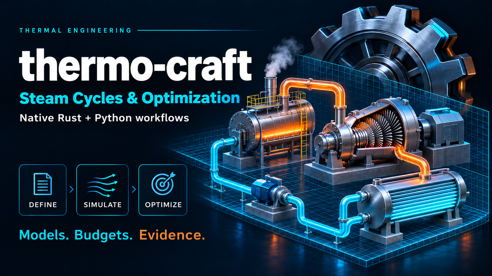

# thermo-craft 0.3.0

A bounded research evaluator for IAPWS-IF97 water and steam properties
(regions 1, 2 and 4) and a fixed steam Rankine cycle, simple or with two
open feedwater heaters. See the [user manual](docs/user-manual.md) for
installation, the model reference and all interfaces, the
[tutorial](docs/tutorial.md) for a short walk-through, the
[model card](docs/model.md) for units, equations and scope, and the
[architecture guide](docs/architecture.md) for the implementation and
measured performance. The [0.3.0 performance log](thermo-craft-performance-log-0.3.0.md)
records this release; the [0.1.0 implementation record](docs/implementation-0.1.0.md)
preserves the original scope.

## Rust CLI and native examples

```sh
cargo run --release --locked -- describe
cargo run --release --locked -- run models/request.json
cargo run --release --locked --example sweep -- models/example.json
cargo run --release --locked --example matrix_scan -- models/example.json
```

The CLI uses versioned JSON with exact model-byte SHA-256, candidate IDs and
explicit work and worker limits. `run -` accepts stdin. Exit 1 indicates a
rejected request. Exit 2 retains classified candidate records when at least
one candidate is incomplete or infeasible.

## Python

Install the matching wheel from `packages/` in a clean environment.
The tested wheel target is Linux x86-64 with a CPython 3.10+ ABI.
Actual clean-environment verification used CPython 3.12.

```python
from thermo_craft import Prepared, load_example

case = load_example()
prepared = Prepared(case["model"])
row = prepared.evaluate(case["parameters"], trace=True)
assert row["status"] == "complete"
print(row["score"])

scores, statuses, steps = prepared.score_matrix([case["parameters"], [2e5, 1.5e6]])
print(scores, statuses, steps)
```

`Prepared.batch` and `Prepared.scores` cross into native code once per batch
with JSON; `Prepared.score_matrix` takes parameter rows (lists or a 2-D
NumPy array) and returns scores, statuses and steps without JSON, which is
the fastest path for optimizers. Native evaluation releases the GIL; workers
evaluate candidates in isolation and return results in input order. The
local Python campaign commits results to SQLite, preserves interrupted
attempts and reuses completed records by candidate, scenario, settings and
build identity. Run `validation/run_campaign.py MODULE models/campaign.json campaign.sqlite`
with the installed package to evaluate or resume the included manifest.

[`examples/python/`](examples/python/README.md) holds application examples
(property tables, an extraction-pressure map, cycle comparison, sensitivity)
and optimization examples with SciPy and fcmaes, each with saved output.

## Verify and rebuild

```sh
cargo test --release --locked
cargo build --release --locked
python validation/validate.py ./target/release/thermo-craft
maturin sdist --out dist
maturin build --release --locked --out dist
```

Independent numerical scripts use Python 3.12. The examples use NumPy 2.3.5,
SciPy 1.17.0 and fcmaes 2.1.0. `validation/optimize.py thermo_craft` is a
short in-process SciPy differential-evolution run. The native sweep needs
only the Rust crate. See `evidence/` for actual runs.
