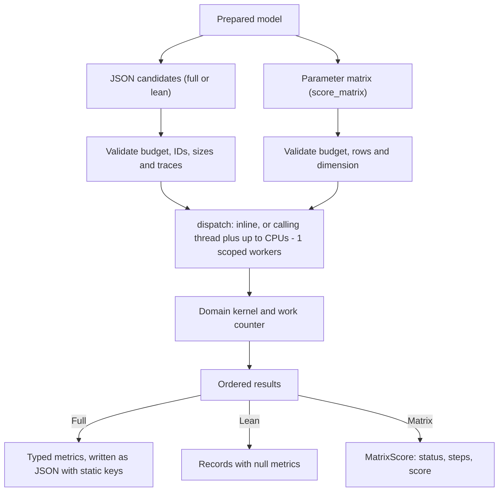

# Thermo Craft architecture

Version 0.3.0. Evaluate bounded IF97 water properties and optimize two
extraction pressures in a fixed Rankine cycle. This document describes the
implementation as of 0.3.0 and its measured performance. The
[user manual](user-manual.md) documents the interfaces, the
[model card](model.md) the equations and scope.

## Evaluation pipeline

| Boundary | Location | Responsibility |
| --- | --- | --- |
| Request and CLI | `src/main.rs`, `src/lib.rs` (`run`, `capabilities`), `models/request.json` | Versioned request schema, exact model-byte hash, typed validation, `Value` output with sorted keys and exit code |
| Python boundary | `python/thermo_craft/__init__.py`, PyO3 module in `src/lib.rs` | `batch`/`scores`: encode once per batch, decode the result envelope; `score_matrix`: rows in, three lists out, no JSON. Every native call releases the GIL |
| Prepared engine | `src/lib.rs` | Own immutable domain data, enforce batch rules, dispatch candidates, classify failures, write ordered results |
| Domain | `src/domain.rs` | Bind the candidate, run the cycle or property query, check feasibility, return the score and typed metrics |
| Property routines | `src/if97.rs`, `src/if97_coefficients.rs` | Gibbs sums, saturation, wet states, inverse states at fixed pressure |
| Campaign | `python/thermo_craft/campaign.py` | Local SQLite replay, attempt journal and result cache |
| Verification | `validation/`, `examples/`, `evidence/` | Independent checks, executable examples, paired performance observations |

## Data and execution contracts

`Prepared::new` hashes the model bytes with SHA-256, deserializes the model
(unknown fields rejected) and validates it before building the domain
caches: the turbine inlet state and the condenser saturation pair. The
Python wrapper encodes models, candidates and budgets with sorted keys,
compact separators and no NaN or infinity. Two inputs with different
serialized bytes can therefore have different provenance hashes. Result
and request schema tags remain at 0.1; the package version is reported
separately.

Every JSON batch validates the budget (workers 1-64, `max_steps`
1-100,000,000, `wall_ms` 1-86,400,000), the candidate count (1-4,096),
unique non-empty IDs of at most 128 bytes, parameter vectors of at most 64
values and at most 16 traced candidates. `score_matrix` applies the same
budget and count rules to its rows, requires a rectangular row-major buffer
and a dimension of at most 64, and has no IDs. The domain receives a
parameter slice in both cases.

**Dispatch.** `dispatch` runs `min(workers, candidates, CPUs)` threads,
where the CPU count is `std::thread::available_parallelism()` read once per
process. One thread means inline evaluation on the calling thread.
Otherwise the calling thread runs one worker loop next to the spawned
scoped threads; all claim indexes from an atomic cursor and write each
result into its own slot, so output is assembled in input order without
sorting. `workers` is therefore an upper bound, and results do not depend
on it.

**Work and budgets.** `Work` counts domain-defined logical steps per
candidate. The unmonitored fast path increments a counter. With
`wall_ms` or `cancel_file` every step checks the cancel file, then the
batch deadline, then the step budget. Domain checks can reject an invalid
candidate before it takes a step. Cancellation and deadlines are
cooperative; fixed-work results agree across worker counts, while
`wall_limit` and `cancelled` outcomes depend on timing.

**Three result paths share one outcome function.** `Prepared::outcome`
runs the domain and maps a nonfinite score to `invalid`. Full records
(`evaluate_json`, Python `batch`) carry typed metrics; lean records
(`scores_json`, Python `scores`) build no metrics and reject traced
candidates; the matrix path (`score_matrix`) returns
`MatrixScore { status, steps, score }`. Status, steps and score are the
same in all three; the score is the same bit for bit. Unit tests check this
for valid, infeasible and invalid rows, `max_steps` limits, a cancel file,
a deadline and several worker counts.

**Typed metrics and direct JSON.** The domain returns a `Metrics` enum
(skipped, property state, cycle) instead of a `serde_json::Value` tree.
Its structs declare fields in sorted key order, so the JSON is
byte-identical to the 0.2.0 sorted maps. `evaluate_json` and `scores_json`
write the envelope, records and metrics with static key bytes; numbers,
strings, IDs, details and failure values go through
`serde_json::to_writer`, so escaping and number formatting are
serde_json's. The derived `Serialize` impls remain for the CLI, whose
`run` converts the batch to a `Value` (sorted keys), and as the reference
in a byte-equality unit test. Library and Python results list record
fields as `id`, `status`, `steps`, `score`, `metrics`, `detail`.

In thermo-craft the `trace` flag adds no fields: full records already
contain every metric. It is validated and counted for engine
compatibility.

## Domain internals

| Layer | Responsibility |
| --- | --- |
| `domain.rs` | Validate the model, prepare inlet and condenser states, solve pressure stages and heater balances, enforce exhaust and power checks, build typed metrics |
| `if97.rs` | Power tables, grouped Gibbs sums and derivatives, saturation pairs, wet states, inverse states at fixed pressure, the hot-end floor table |
| `if97_coefficients.rs` | IAPWS R7-97(2012) coefficient tables for regions 1, 2 and 4 |

The cycle reuses the prepared inlet and condenser states. The regenerative
case creates saturation pairs at the two extraction pressures, steps
through three turbine stages and three pumps, then solves the open-heater
mixing fractions. It returns minus the efficiency only after the
whole-cycle and local heater energy checks pass.

**Gibbs sums.** `curvature_terms` evaluates gamma and its derivatives in
pi and tau (and the second tau derivative when asked) for regions 1 and 2.
The coefficient tables are grouped by pressure exponent at compile time:
each short reduced-temperature series is summed first and then scaled by
its pressure power, and the value and pressure derivative share one inner
sum. Compile-time term tables hold the power-table indices of y^J,
y^(J-1) and y^(J-2) and the factors n*J and n*J*(J-1). Power tables
(reduced temperature, its inverse for region 1, and pressure) are built
from x^1..x^8 and then x^k = x^(k-8) * x^8, so eight short independent
multiplication chains replace one long chain. The region 2 ideal-gas part
uses the same precomputed factors.

**Inverse states.** `invert` finds the state at a saturation pair's
pressure with a given enthalpy or entropy. A target between the saturated
liquid and vapor values is a wet state from the lever rule and charges no
steps. A single-phase target is bracketed between the saturation
temperature and 273.16 K (liquid) or 1073.15 K (vapor):

- The bracket value at the saturation temperature is taken from the
  saturation pair; it repeats that state's computation exactly (a unit
  test checks bit equality).
- For vapor targets a process-wide table of h and s at 1073.15 K on 64
  log-spaced pressures gives a floor (both fall with pressure at fixed
  temperature); a target below the floor is inside the bracket, so the
  exact hot-end evaluation is skipped. Otherwise it is evaluated and
  compared as before, so the `infeasible` classification is unchanged. A
  unit test checks the floors on 20,000 pressures.
- The solve is a safeguarded Newton iteration using cp (enthalpy) or
  cp/T (entropy) from the second tau derivative, starting from the secant
  through the bracket ends; a step that leaves the current bracket falls
  back to bisection. It stops after a Newton step of at most 1e-6 K, three
  or four evaluations in the workloads, leaving an error far below the
  2^-41 bracket width of the 40-step bisection used up to 0.2.0. A
  test-only bisection reference bounds the difference.
- The 40 logical steps of that bisection are still charged, before the
  solve, with the same limit, cancel and deadline checks, so step counts
  and `max_steps` outcomes are unchanged.

A full thermodynamic state is reconstructed at the solved temperature.
These are bounded property routines, with no region 3 and no arbitrary
plant topology.

## Structural changes in 0.3.0

| Round | Change |
| ---: | --- |
| 1 | Typed score-matrix API (`Prepared::score_matrix`, `MatrixScore`, Python `score_matrix`); shared `outcome` and `dispatch` for all paths |
| 2 | Safeguarded Newton inverse with a second reduced-temperature derivative, still charging 40 steps |
| 3 | Typed metrics enum instead of `serde_json::Value` trees |
| 4 | Near bracket value taken from the saturation pair; inverse pressure derived from the pair |
| 5 | Power tables from short independent multiplication chains |
| 6 | Gibbs terms grouped by pressure exponent at compile time |
| 7 | Compile-time term factors and combined power-table indices |
| 8 | Dispatch on the calling thread, capped at the CPU count |
| 9 | Hot-end floor table skips the far bracket evaluation |
| 10 | Result JSON written directly with static keys |

`Evaluation` became crate-private because it now carries the domain's
typed metrics. Rounds 2, 5, 6 and 9 change values in their last bits;
rounds 3, 4, 7, 8 and 10 are bit-identical. The
[0.3.0 performance log](../thermo-craft-performance-log-0.3.0.md) lists
each round's measurement.

## Persistence and boundaries of evidence

The local campaign hashes the installed extension bytes plus each
scenario, model, candidate and work settings to locate reusable records.
SQLite stores completed, invalid and infeasible results and keeps an
append-only journal of attempts. Cancelled or time-limited attempts remain
in the journal and can be retried. SQLite commits each chunk atomically. A
new extension build changes the cache namespace. The workflow is local and
exposes no distributed worker protocol.

The package contains source, a source distribution, and a validated Linux
x86-64 wheel. The crate and source distribution ship source, docs,
examples, models and validation scripts; release evidence, packages and
patch series are in the release ZIP.

## Performance

All numbers in this section were measured for this release on one host:
**2 vCPUs, Intel(R) Xeon(R) Processor @ 2.10GHz (KVM guest), Rust 1.97.0,
CPython 3.12.3**. The host was shared with other jobs, and every
measurement ran under an exclusive CPU lock. Do not compare these numbers
with the 0.2.0 log, which was measured on another host (AMD EPYC 9V74,
4 CPUs, Rust 1.88).

### 0.2.0 to 0.3.0

`validation/performance_pair.py --samples 11` with the saved 0.2.0
benchmark binary and the round-10 binary, alternating process order. Times
are median milliseconds per prepared call. "Paired median" is the median of
the 11 adjacent before/after ratios, which is robust to slow host-speed
drift. The `parallel` workload requests 4 workers on this 2-vCPU host;
0.2.0 starts four threads, 0.3.0 runs two (the calling thread and one
worker). The matrix rows use 0.2.0 lean scores as the baseline, since
0.2.0 has no matrix API. Evidence: `evidence/performance-0.3.0/cumulative/`.

| Workload | Case | 0.2.0 ms | 0.3.0 ms | Before / after | Paired median |
| --- | --- | ---: | ---: | ---: | ---: |
| `one` | 1 full record | 0.0473 | 0.0063 | 7.52x | 8.04x |
| `serial` | 96 full records, one worker | 3.5064 | 0.3369 | 10.41x | 10.20x |
| `parallel` | 96 full records, 4 workers requested | 2.6053 | 0.3588 | 7.26x | 7.37x |
| `trace` | 12 traced full records | 0.4143 | 0.0445 | 9.30x | 9.92x |
| `invalid` | 1,024 invalid candidates, 63 values each | 1.4739 | 1.4503 | 1.02x | 1.02x |
| `domain` | 48 full records, 950 K inlet | 2.4193 | 0.2184 | 11.08x | 10.87x |
| `domain2` | 48 full property records | 0.1131 | 0.0313 | 3.62x | 2.74x |
| lean `serial` | 96 lean records | 3.2052 | 0.2149 | 14.91x | 13.73x |
| lean `domain` | 48 lean records, 950 K | 1.9426 | 0.1408 | 13.80x | 13.58x |
| lean `domain2` | 48 lean property records | 0.0517 | 0.0328 | 1.58x | 1.50x |
| matrix `serial` | 96 matrix rows (baseline: 0.2.0 lean) | 2.9197 | 0.2026 | 14.41x | 14.61x |
| matrix `domain` | 48 matrix rows, 950 K (baseline: 0.2.0 lean) | 1.8976 | 0.1333 | 14.23x | 14.52x |

Supplementary rows (same binaries): matrix `domain2` 0.0341 -> 0.0073 ms
(4.70x) and matrix `invalid` 1.4337 -> 0.0389 ms (36.8x) against 0.2.0 lean
(`supplement-matrix-*.json`). The two `domain2` rows take about 30 us per
call, where process-level noise is large: the official lean `domain2`
median (0.0328 ms) is above the full one, while 41-sample confirmations
give 0.0236 ms lean and 0.0314 ms full (`supplement-*-domain2-confirm41.json`).

### Where a call's time goes

`examples/breakdown.rs` times the phases through the public API, with the
phases interleaved in 25 rounds; the table shows the minimum in
microseconds per call (`evidence/performance-0.3.0/breakdown.json` also has
medians). *decode* parses the candidate JSON; *matrix* is `score_matrix` on
the same values, that is domain evaluation without JSON; *lean* is
`scores_json`; *full* is `evaluate_json`.

| Workload | Candidates | decode | matrix | lean | full | Domain share of full |
| --- | ---: | ---: | ---: | ---: | ---: | ---: |
| `one` | 1 | 0.13 | 1.71 | 2.13 | 3.46 | 49% |
| `serial` | 96 | 11.6 | 158.5 | 183.3 | 305.3 | 52% |
| `domain` | 48 | 6.4 | 106.6 | 117.2 | 183.3 | 58% |
| `domain2` | 48 | 6.1 | 6.7 | 16.8 | 23.6 | 28% |
| `invalid` | 1,024 | 1,016.6 | 31.7 | 1,228.5 | 1,236.1 | 3% |

- A regenerative candidate costs about 1.65 us of domain evaluation
  (serial; 2.2 us at the 950 K inlet with four single-phase inverses).
- Lean JSON adds about 0.25 us per candidate: decode plus the lean
  envelope.
- A full record adds about 1.3 us of metric construction and JSON writing
  on top of lean; number formatting is most of it (about 55 numbers per
  record).
- A property query costs about 0.14 us of domain time; its JSON is more
  than twice that.
- `invalid` is dominated by parsing 64,512 JSON numbers; the domain
  rejects each candidate in about 30 ns.
- Preparing the example model costs 1.07 us.

### Per-call cost of full, lean and matrix calls

Native (from the breakdown above): one candidate costs 1.71 us (matrix),
2.13 us (lean) or 3.46 us (full); per candidate in a 96-batch, 1.65, 1.91
and 3.18 us.

Python, installed wheels on one CPU (`taskset -c 0`), microseconds per call,
minimum of 25 interleaved rounds (`validation/python_call_costs.py`;
`python-call-costs-0.3.0.json`, `python-call-costs-0.2.0.json`):

| Call | 0.2.0 | 0.3.0 |
| --- | ---: | ---: |
| `evaluate` (one full record) | 59.2 | 27.4 |
| `scores` (one candidate) | 35.7 | 10.0 |
| `score_matrix` (one row) | - | 4.7 |
| `batch` (96 full records) | 4,816 | 1,931 |
| `scores` (96 candidates) | 2,747 | 362 |
| `score_matrix` (96 rows) | - | 190 |
| `Prepared(model)` | 6.2 | 5.8 |

In Python the JSON boundary dominates full records: decoding the 96-record
result costs far more than the native evaluation. `score_matrix` is within
about 30 us of the native cost for 96 rows.

### Worker scaling

From the same breakdown, minimum microseconds per call; on this host at
most two threads run, so 2 and 4 requested workers behave alike:

| Batch | API | 1 worker | 2 workers | 4 workers requested |
| --- | --- | ---: | ---: | ---: |
| 96 candidates | matrix | 153 | 143 | 126 |
| 96 candidates | full | 300 | 309 | 287 |
| 1,024 candidates | matrix | 1,749 | 1,048 | 1,016 |
| 1,024 candidates | full | 3,560 | 3,011 | 2,878 |

Starting a thread costs tens of microseconds on this VM, so a 96-candidate
batch gains little. A 1,024-row matrix call runs 1.7x faster on two
threads. Full records gain less because results are written to JSON on
one thread after evaluation.

### Installed Python optimization

`validation/optimize_performance.py`: seeded SciPy differential evolution
(48 objective calls) plus a traced replay of the winner, seven interleaved
runs per configuration on CPU 0. The 0.3.0 wheel was built with maturin
from the extracted 0.3.0 sdist; the 0.2.0 wheel is the delivered one.
Median milliseconds; the total median is computed per run
(`python-optimization.json`).

| Configuration | Prepare ms | Search ms | Replay ms | Total ms | 0.2.0 full / total |
| --- | ---: | ---: | ---: | ---: | ---: |
| v0.2.0-full | 0.091 | 8.662 | 0.099 | 8.863 | 1.00x |
| v0.2.0-scores | 0.083 | 6.699 | 0.135 | 6.911 | 1.28x |
| v0.3.0-full | 0.084 | 6.642 | 0.049 | 6.768 | 1.31x |
| v0.3.0-scores | 0.093 | 5.790 | 0.067 | 5.942 | 1.49x |
| v0.3.0-matrix | 0.094 | 4.637 | 0.091 | 4.836 | 1.83x |

All runs made 48 evaluations with 0 failures and selected
`[362432.0581474683, 2033861.965363634]`. The replay score is
-0.38412704852860363 with 0.2.0 and -0.38412704852854795 with 0.3.0
(relative difference 1.4e-13). With 48 evaluations of about 2 us each,
SciPy's own per-generation work is most of the remaining search time.

### What dominates now and which API to use

- **Optimizers** should use `score_matrix`, ideally one call per
  population: the per-row cost in Python is then close to the native
  domain cost, while a one-row call still pays about 3 us of Python
  overhead.
- **JSON users** who need IDs and details but not metrics should use
  `scores`; it avoids the metrics and most of the decode cost.
- **Full records** are for inspection and replay. Their cost is now
  dominated by JSON (writing natively, parsing in Python), not by the
  thermodynamics.
- **Workers**: keep `workers=1` for batches of up to a few hundred
  candidates; for large matrix batches set `workers` to the number of idle
  CPUs. Requests above the CPU count are capped.
- **Remaining native cost** in a regenerative candidate is the Gibbs
  evaluations: four for the two saturation pairs, then per single-phase
  inverse three (enthalpy) or four (entropy) Newton evaluations and one
  reconstruction; 17 for the packaged example, 22 at the 950 K inlet. The
  `invalid` workload is bound by JSON number parsing and changed little.
